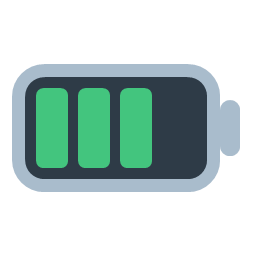
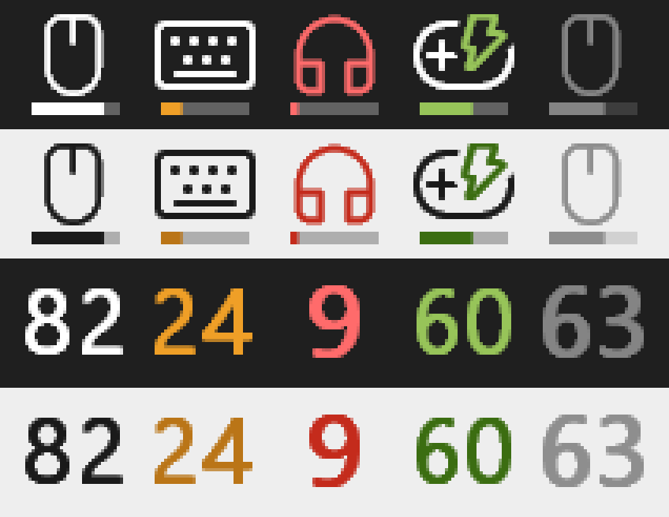

<div align="center">



# Battery Tray

**Battery levels of your wireless mouse, keyboard and headphones, right in the Windows taskbar.**

[](https://github.com/andregulbrandsen/battery-tray/actions/workflows/build.yml)
[](https://github.com/andregulbrandsen/battery-tray/releases/latest)
[](LICENSE)




</div>

## Why

Windows hides accessory battery levels a few clicks deep in Settings, and vendor apps are heavy.
Battery Tray puts **one small icon per device** in the notification area, so you see a low mouse
before it dies mid-game, without installing anything big.

- **Tiny:** a single ~440 KB exe using about 2 MB of memory and practically no CPU
- **No admin rights, no installer, no network access**
- **Native look:** Windows' own Segoe Fluent icons, follows the light/dark taskbar and display scaling

## Features

- **One icon per device**, showing either an icon with a level bar or just the percentage
- **Colors that mean something:** amber at 30% and below, red below 15%, green while charging
- **Low-battery alert** as a Windows notification (threshold configurable, or off)
- **Remembers sleeping devices:** the last known level stays visible, dimmed, until the device wakes up
- **Tooltips** with the device name, level, connection and when it was last seen
- **Rename, change icon or hide** any device from the right-click menu
- **Start with Windows** from the menu, per user, no admin needed

## Supported devices

| Source | Devices | How it reads the level |
| --- | --- | --- |
| **Bluetooth** | Mice, keyboards, headphones, controllers that report battery to Windows | The same value shown in *Settings → Bluetooth & devices* |
| **Logitech** | Wireless devices on **Lightspeed**, **Bolt** and **Unifying** receivers | Logitech's HID++ 2.0 protocol, read-only |

Some devices report an exact percentage. Others only report a voltage or a rough level, which
shows as "about 60%" in the tooltip.

## Install

1. Download `battery-tray-<version>-windows-x64.zip` from the
   [latest release](https://github.com/andregulbrandsen/battery-tray/releases/latest).
2. Extract it somewhere permanent, for example `%LOCALAPPDATA%\Programs\Battery Tray`.
3. Run `battery-tray.exe`.
4. Windows 11 puts new tray icons in the overflow (**^**) menu. Drag each icon onto the taskbar
   once and it stays there.
5. Optional: right-click an icon → **Start with Windows**.

> [!NOTE]
> The exe isn't code-signed yet, so SmartScreen may show *"Windows protected your PC"* the first
> time. Choose **More info → Run anyway**. Each release includes `SHA256SUMS.txt` so you can check
> the download. On managed work PCs where SmartScreen can't be bypassed, ask your IT department
> to allow the app.

## Usage

Right-click (or left-click) any Battery Tray icon:

| Menu item | What it does |
| --- | --- |
| **Rename…** | Give the device a friendlier name |
| **Change icon** | Mouse, keyboard, headphones, controller or other |
| **Hide this device** | Remove its icon; bring it back via **Show hidden devices** |
| **Display** | *Icon and level bar* or *Number only* |
| **Low-battery alert** | Off, or below 10 / 15 / 20 / 30% |
| **Start with Windows** | Adds or removes a per-user startup entry |
| **Refresh now** | Reads all devices immediately (otherwise every 60 seconds) |

Settings and last-known levels are stored in `%APPDATA%\BatteryTray\config.ini`.

## Troubleshooting

<details>
<summary><b>My device doesn't show up</b></summary>

- **It may be asleep.** Many wireless mice and keyboards don't answer while sleeping. Move it and
  wait up to a minute, or use **Refresh now**.
- **It may not report battery to Windows.** Some headphones only share their level with the
  vendor's own app. If *Settings → Bluetooth & devices* shows no percentage, Battery Tray can't
  see one either.
- **Older Logitech Unifying setups:** if Logitech's legacy SetPoint/Unifying driver owns the
  receiver, normal apps can't talk to it.
- To see exactly what Battery Tray detects, run `battery-tray.exe --scan scan.txt` and open the
  file. For a deeper look, [`tools/probe/probe.ps1`](tools/probe/probe.ps1) lists every
  Bluetooth and Logitech device and why it does or doesn't report a battery.

</details>

<details>
<summary><b>"Start with Windows" doesn't stick</b></summary>

Start Battery Tray from File Explorer or the Start menu. Programs launched from inside sandboxed
or packaged apps (some terminals, for example) can get a private copy of the registry, so the
startup entry never reaches Windows. Battery Tray reads the entry back and warns you if the
change didn't take effect.

</details>

## Build from source

Requires Rust with the GNU toolchain (no Visual Studio needed):

```
rustup toolchain install stable-x86_64-pc-windows-gnu
cargo build --release
```

The exe lands in `target\release\battery-tray.exe`. Useful extras:

- `battery-tray.exe --scan out.txt` writes one scan's readings to a file
- `battery-tray.exe --preview out.bmp` renders every icon variant (both themes, 16/24/32 px)
- `pwsh -File tools\make-icon.ps1` regenerates the app icon

`build.rs` embeds the icon, version info and manifest by writing the resource section itself,
so no `rc.exe` or `windres` is needed.

### Releasing

GitHub Actions builds and tests every push and pull request. To publish a version:

1. Bump `version` in `Cargo.toml`, run `cargo build` (updates `Cargo.lock`) and commit.
2. Tag and push: `git tag v0.2.0` then `git push origin v0.2.0`.
3. The workflow builds the zip and `SHA256SUMS.txt` and creates a **draft** release. Review the
   notes on GitHub and publish it.

The tag must match the version in `Cargo.toml`. To package locally instead, run
`pwsh -File tools\package.ps1 -Version 0.2.0` after a release build.

<details>
<summary><b>Project layout</b></summary>

| Path | Purpose |
| --- | --- |
| `src/main.rs` | Hidden window, tray icons, menu, worker thread |
| `src/providers/bluetooth.rs` | Bluetooth battery levels from Windows device properties |
| `src/providers/logitech.rs` | Logitech HID++ 2.0 over receivers and direct USB |
| `src/render.rs` | Icon drawing: Segoe Fluent glyph with level bar, or number |
| `src/config.rs` | Settings file |
| `src/input.rs` | Rename prompt |
| `build.rs` | Embeds icon, version info and manifest |
| `tools/package.ps1` | Builds the release zip and checksums |
| `tools/make-icon.ps1` | Draws the app icon |
| `tools/probe/` | PowerShell discovery script for supported devices |

</details>

## License

[MIT](LICENSE)
